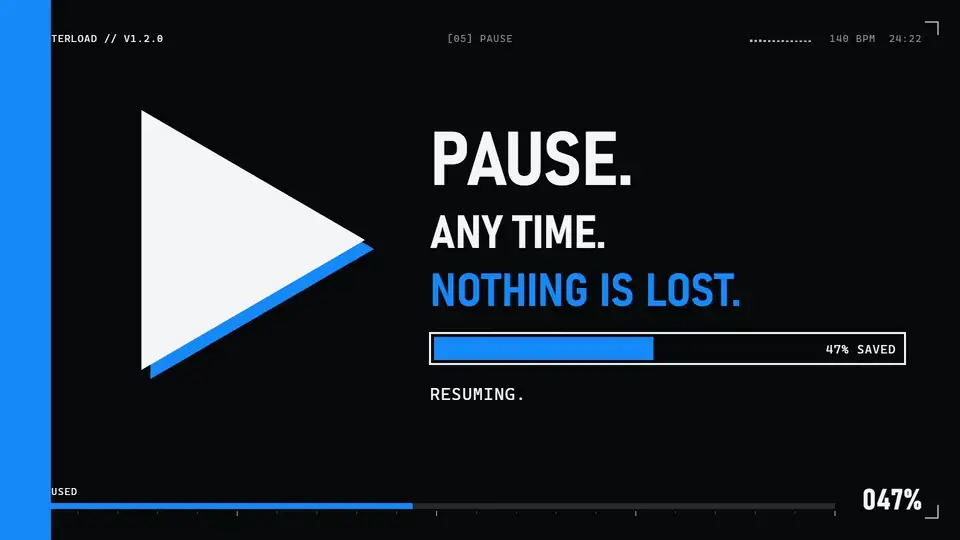
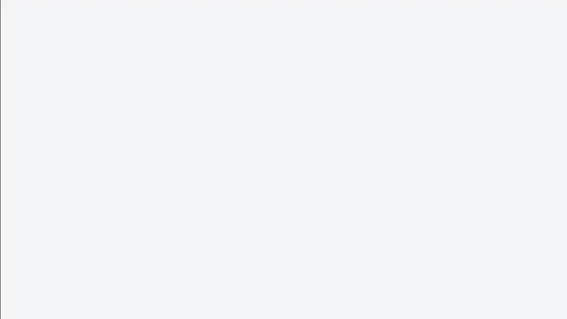
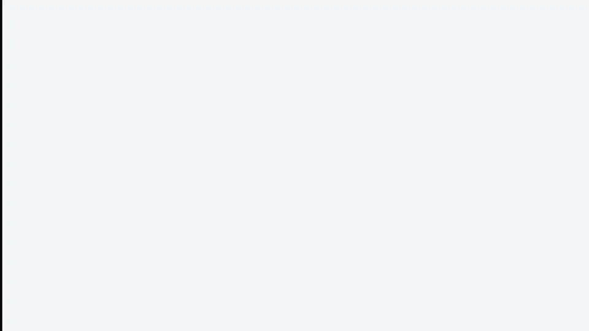

<p align="center">
  
</p>

<h1 align="center">Enterload</h1>

<p align="center">
  Paste a link, get the video. A free video downloader for Windows that updates itself.
</p>

<p align="center">
  <a href="https://github.com/Agrysif/Enterload/releases/latest"><b>Download for Windows</b></a>
  ·
  <a href="README.ru.md">Русская версия</a>
</p>

<p align="center">
  <a href="https://github.com/Agrysif/Enterload/releases/download/v1.2.0/Enterload-trailer.mp4"></a>
</p>

<p align="center">
  <a href="https://github.com/Agrysif/Enterload/releases/download/v1.2.0/Enterload-trailer.mp4"><b>▶ Watch the trailer</b></a> · 53 seconds, 1080p
</p>

## What it does

Paste a link from YouTube, VK, Rutube, TikTok, Twitch, Vimeo or any of the other sites [yt-dlp](https://github.com/yt-dlp/yt-dlp) supports. Enterload shows everything about the video, then downloads it in the quality you pick.

<p align="center">
  
</p>

- **Up to 4K**, or 1080p, 720p, 480p, 360p, or just the sound as MP3.
- **FFmpeg is inside.** Best quality and embedded covers work right after installation.
- **Pause and resume.** A paused download continues from where it stopped, and a cancelled one cleans up after itself.
- **Video details before you download**: cover, channel, resolution, frame rate, size, views, categories, cast, tags and description.
- **Files next to the video**: the cover as `.jpg` and a `.txt` with the title, link, description and tags. Both are optional.
- **History** with search, filters and days, plus **statistics** on size, length and speed.
- **Light and dark themes** and 8 accent colors. With **site color** on, the app takes the color of the site in your link.
- **Automatic updates.** New versions download in the background and install on restart.

<p align="center">
  
</p>

## Install

Download `Enterload-Setup-x.y.z.exe` from the [latest release](https://github.com/Agrysif/Enterload/releases/latest) and run it. Windows 10 or 11 is required.

Windows may show “Windows protected your PC”. Click “More info”, then “Run anyway”. The app carries our own signature rather than a paid certificate, so Windows doesn't recognize the publisher yet.

`Enterload-x.y.z-portable.exe` runs without installation, but it can't update itself.

The interface is in Russian.

## Support the project

Enterload is free. If it saves you time, you can [say thanks here](https://www.donationalerts.com/r/agrysif).

## Build from source

Requires Node.js 20 or newer.

```bash
npm install
npm start
```

| Command | What it does |
|---|---|
| `npm start` | development mode with hot reload |
| `npm run preview` | builds the interface and runs it like a release |
| `npm run build` | signed installer and portable version in `release/` |
| `npm run release` | the same, plus a GitHub release |

FFmpeg is downloaded into `vendor/ffmpeg` during the build. The signing key stays outside the repository, so builds from a fork need their own key and their own `RELEASE_CERT_THUMBPRINT` in `src/main.js`.

## Credits

Downloads are powered by [yt-dlp](https://github.com/yt-dlp/yt-dlp) and [FFmpeg](https://ffmpeg.org/), see [THIRD-PARTY-NOTICES.md](THIRD-PARTY-NOTICES.md). The videos in the trailer are open films by [Blender Studio](https://studio.blender.org/).

Please download only what you have the right to.
