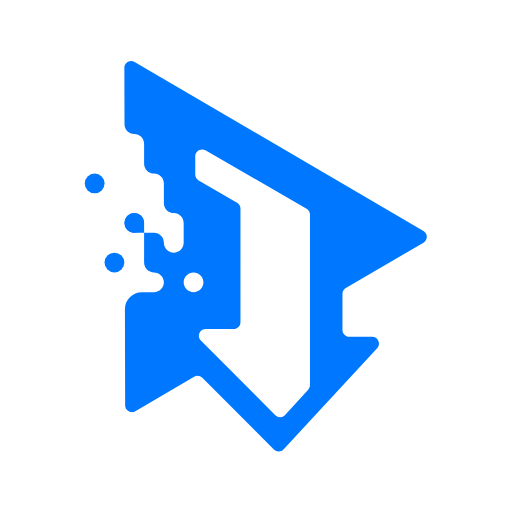
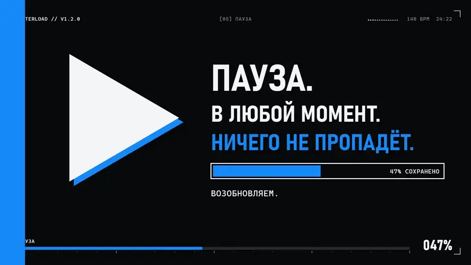
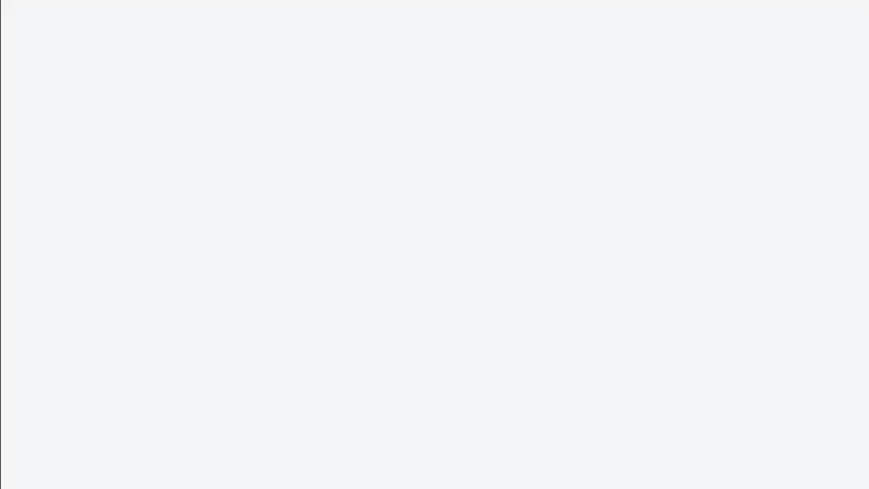
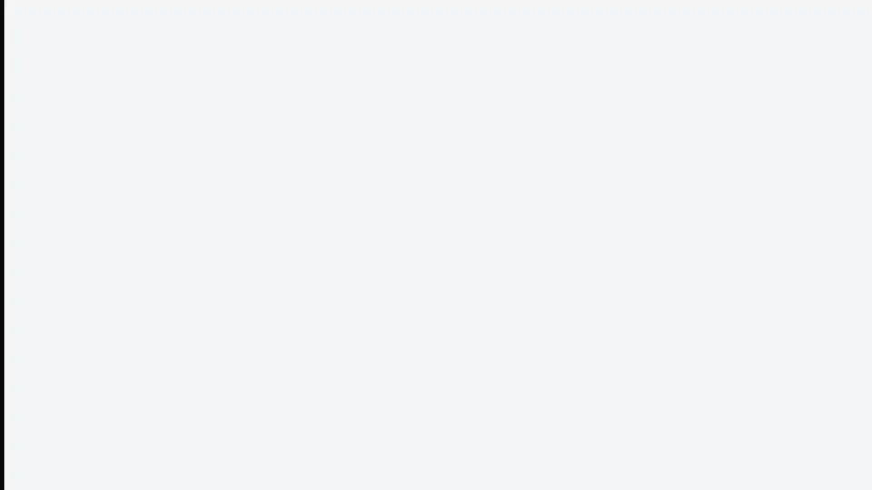

<p align="center">
  
</p>

<h1 align="center">Enterload</h1>

<p align="center">
  Вставьте ссылку и получите видео. Бесплатный загрузчик для Windows, который обновляется сам.
</p>

<p align="center">
  <a href="https://github.com/Agrysif/Enterload/releases/latest"><b>Скачать для Windows</b></a>
  ·
  <a href="README.md">English version</a>
</p>

<p align="center">
  <a href="https://github.com/Agrysif/Enterload/releases/download/v1.2.0/Enterload-trailer-ru.mp4"></a>
</p>

<p align="center">
  <a href="https://github.com/Agrysif/Enterload/releases/download/v1.2.0/Enterload-trailer-ru.mp4"><b>▶ Смотреть трейлер</b></a> · 53 секунды, 1080p
</p>

## Что умеет

Вставьте ссылку с YouTube, VK, Rutube, TikTok, Twitch, Vimeo или любого другого сайта, который поддерживает [yt-dlp](https://github.com/yt-dlp/yt-dlp). Enterload покажет всё о видео и скачает его в нужном качестве.

<p align="center">
  
</p>

- **До 4K**, либо 1080p, 720p, 480p, 360p или только звук в MP3.
- **FFmpeg внутри.** Лучшее качество и встраивание обложки работают сразу после установки.
- **Пауза и продолжение.** Загрузка продолжается с того же места, а отменённая убирает за собой временные файлы.
- **Всё о видео до скачивания:** обложка, канал, разрешение, кадры, размер, просмотры, категории, актёры, теги и описание.
- **Файлы рядом с видео:** обложка в `.jpg` и `.txt` с названием, ссылкой, описанием и тегами. Оба можно отключить.
- **История** с поиском, фильтрами и группировкой по дням, а ещё **статистика** по размеру, длительности и скорости.
- **Светлая и тёмная темы** и 8 акцентных цветов. С **цветом сайта** приложение окрашивается под сайт из ссылки.
- **Автообновление.** Новая версия скачивается в фоне и ставится при перезапуске.

<p align="center">
  
</p>

## Установка

Скачайте `Enterload-Setup-x.y.z.exe` из [последнего выпуска](https://github.com/Agrysif/Enterload/releases/latest) и запустите. Нужна Windows 10 или 11.

Windows может показать «Система Windows защитила ваш компьютер». Нажмите «Подробнее», затем «Выполнить в любом случае». Приложение подписано нашей собственной подписью, а не платным сертификатом, поэтому издатель для Windows пока неизвестен.

`Enterload-x.y.z-portable.exe` работает без установки, но обновляться сам не умеет.

## Поддержать проект

Enterload бесплатный. Если он экономит вам время, [сказать спасибо можно здесь](https://www.donationalerts.com/r/agrysif).

## Сборка из исходников

Нужен Node.js 20 или новее.

```bash
npm install
npm start
```

| Команда | Что делает |
|---|---|
| `npm start` | режим разработки с hot reload |
| `npm run preview` | собирает интерфейс и запускает как релиз |
| `npm run build` | подписанный установщик и portable-версия в `release/` |
| `npm run build:dir` | только распакованная сборка `release/win-unpacked` |
| `npm run release` | то же, что `build`, плюс выпуск на GitHub |
| `npm run fetch:ffmpeg` | скачать FFmpeg в `vendor/ffmpeg` (сборка делает это сама) |
| `npm run update:yt-dlp` | скачать свежий yt-dlp в `node_modules` |

### Структура

```
src/
  main.js              — главный процесс: окно, IPC, yt-dlp, автообновление
  preload.js           — безопасный мост window.enterload
  renderer/
    App.jsx            — оболочка: боковая панель, навигация, тема, уведомления
    hooks.js           — анализ ссылки, загрузчик, обновления
    pages/             — экраны: загрузка, история, статистика, ошибки, настройки
    ui.jsx             — базовые компоненты
    format.js          — форматирование чисел, размеров, дат
    theme.js           — акцентные цвета и цвета сайтов
    charts.js          — настройка Chart.js
    styles.css         — дизайн-система
scripts/               — сборка и публикация, загрузка FFmpeg
promo/                 — исходник трейлера (музыка и кадры в git не входят)
```

### Выпуск обновления

1. Поднять версию в `package.json` и переписать `build/release-notes.md`.
2. Выполнить `npm run release`.

Для публикации нужен авторизованный GitHub CLI: `vendor/gh/bin/gh.exe` (не в git) или `gh` из `PATH`. Токен хранится в хранилище Windows, вводить его не нужно. Переменная `GH_TOKEN` важнее, если задана.

Приложение проверяет обновления при запуске и раз в 6 часов. Portable-версия обновляться сама не умеет и предлагает скачать новую.

### Подпись

Ключ подписи лежит вне проекта: `Документы\Enterload-signing` (`enterload-signing.pfx` и `signing.json`). **В репозиторий он попадать не должен.** Сделайте его резервную копию: приложение принимает только обновления, подписанные этим ключом, и без него уже установленные копии обновить автоматически не получится.

Сертификат самоподписанный: он подтверждает, что обновление выпустили мы, но не убирает предупреждение Windows SmartScreen. Для этого нужен сертификат доверенного центра. Сборке из форка нужен свой ключ и свой `RELEASE_CERT_THUMBPRINT` в `src/main.js`.

### Где хранятся данные

История, журнал ошибок и настройки — в `%APPDATA%\enterload3\enterload-data.json`. Обновлённый из настроек yt-dlp кладётся в `%APPDATA%\enterload3\bin\`. Для отдельного профиля можно задать переменную окружения `ENTERLOAD_DATA_DIR`.

## Благодарности

Загрузку обеспечивают [yt-dlp](https://github.com/yt-dlp/yt-dlp) и [FFmpeg](https://ffmpeg.org/), подробнее в [THIRD-PARTY-NOTICES.md](THIRD-PARTY-NOTICES.md). В трейлере показаны открытые фильмы [Blender Studio](https://studio.blender.org/).

Скачивайте только то, на что у вас есть права.
